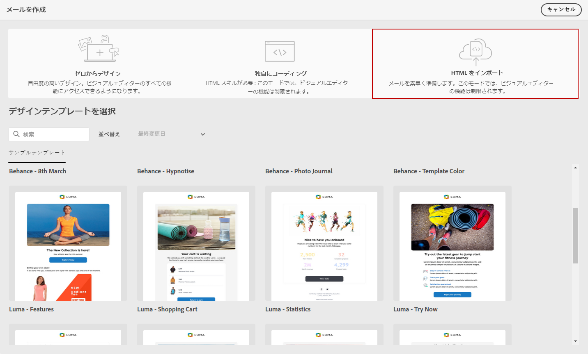
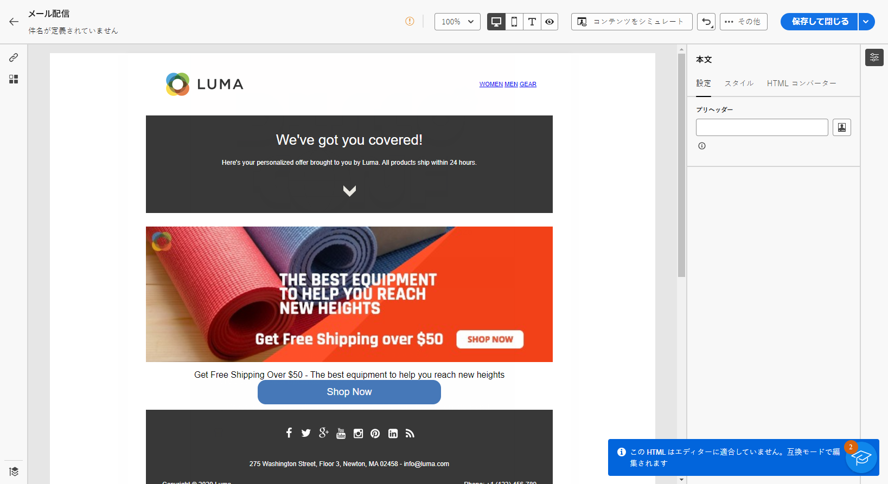
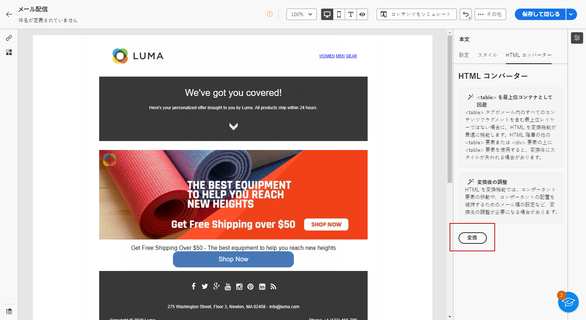

# メールコンテンツの読み込み {#existing-content}

>[!CONTEXTUALHELP]
>id="acw_deliveries_email_import_content"
>title="既存のメールコンテンツの使用"
>abstract="E メールデザイナーを使用すると、既存の HTML コンテンツをインポートできます。 このコンテンツは、スタイルシートが組み込まれた HTML ファイルや、HTML ファイル、スタイルシート（.css）および画像を含んだ .zip フォルダーにすることができます。"

E メールデザイナーで既存の HTML コンテンツを読み込むことができます。 このコンテンツには次のようなものがあります。

* スタイルシートが組み込まれた **HTML ファイル**
* HTML ファイル、スタイルシート（.css）および画像を含んだ **.zip フォルダー**。

>[!NOTE]
>
>.zip ファイル構造に制約はありません。 ただし、.zip フォルダーのツリー構造内に合わせて、相対参照を指定する必要があります。

>[!IMPORTANT]
>
>電子メールコンテンツでHTML `<base>` タグを使用しないでください。 セキュリティ上の理由から、このタグはサポートされておらず、コンテンツエディターでのコンテンツの読み込みを妨げる可能性があります。 代わりに、リンクと外部リソースに絶対URLを使用してください。

➡️ [ビデオでこの機能を確認する](#video)

HTML コンテンツを含んだファイルをインポートするには、次の手順に従います。

1. [E メールデザイナー](get-started-email-designer.md)のホームページで、「**[!UICONTROL HTML を読み込む]**」を選択します。

   {zoomable="yes"}

1. HTML コンテンツを含む HTML または .zip ファイルをドラッグ＆ドロップし、「**[!UICONTROL インポート]**」をクリックします。

1. HTML コンテンツがアップロードされると、コンテンツは&#x200B;**[!UICONTROL 互換性モード]**&#x200B;になります。

   このモードでは、テキストのパーソナライズ、リンクの追加、コンテンツへのアセットの組み込みが可能です。

   {zoomable="yes"}

1. E メールデザイナーのコンテンツコンポーネントを活用するには、「**[!UICONTROL HTML コンバーター]**」タブに移動し、「**[!UICONTROL 変換]**」をクリックします。

   {zoomable="yes"}

   >[!NOTE]
   >
   >`<table>` タグを HTML ファイルの最初のレイヤーとして使用すると、最上位レイヤータグの背景や幅の設定などのスタイルが失われる場合があります。

1. E メールデザイナーの機能を使用して、必要に応じてインポートしたファイルをパーソナライズします。 [詳細情報](content-components.md)

## チュートリアルビデオ {#video}

HTML をアップロードしてメールを作成する方法、E メールデザイナーと互換性を持たせる方法、テンプレートに変換する方法について説明します。

>[!VIDEO](https://video.tv.adobe.com/v/3427633/?quality=12)